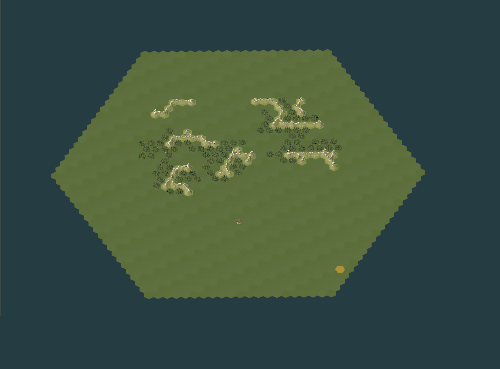

# Map orientation (user decision, 2026-11-14)

**The map editor view above IS the map's orientation.** Every map (M1–M5 and later) is designed and read
exactly as the map editor (`tools/dev_visual_lab/map_editor.gd`) shows it at its default camera:

- The board is a flat-topped hexagon: pointed corners at the left and right, flat edges at the top and bottom.
- **North = top of the editor view, south = bottom of the editor view** (editor world `-z` / `+z`;
  in axial editor coords south is increasing `r + q/2`).
- **The player's army (blue / 아군) always starts at the SOUTH edge** (bottom of the editor view).
  The enemy's start depends on the map, but the player is never anywhere but the south.

Rules for code and data:

1. Never design or describe a map in any other orientation. When a map is drawn, captured or explained,
   south is at the bottom, as in the editor.
2. The game's battle view must show the same picture as the editor: blue at the bottom of the screen.
   The existing import convention `G(q,r) = E(-q,-r)` (RULES_V2_SPEC.md, `tools/rules_v2/gen_m1_gameplay.py`,
   `bake_editor_map.gd` rotating the baked scene 180 deg) is only a coordinate change for the game camera
   (`PresentationOrientation.BATTLE_BLUE_NEAR_SIDE_YAW`); the visible result must stay identical to the editor.
   If a change ever makes the game picture differ from the editor picture, the game side is wrong.
3. Rosters, deployment zones and spawn generators place blue on the southern rows of the editor map.
